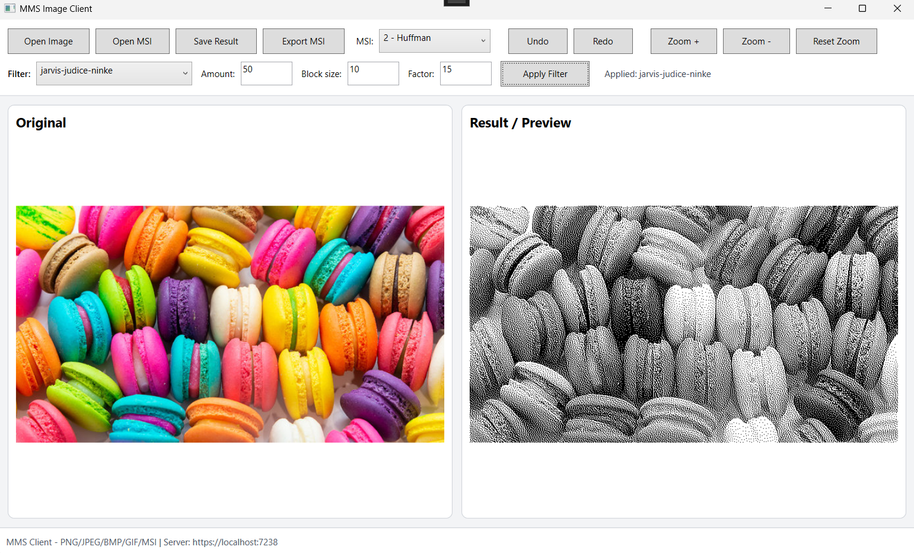
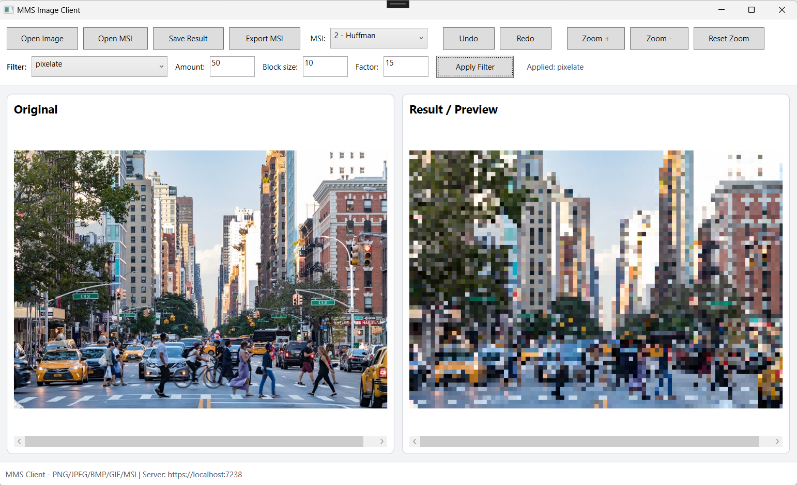
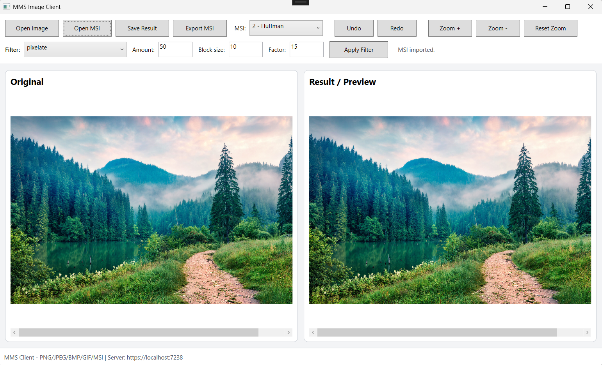
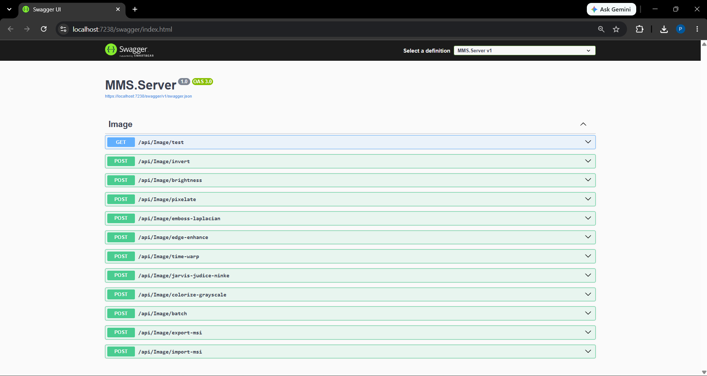
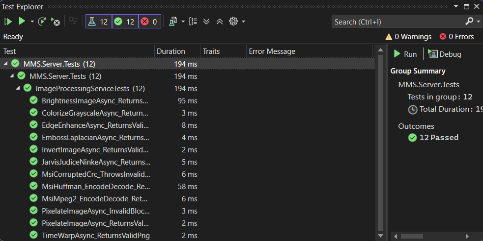

# Image Processing – Client/Server System with a Custom Image Format

A client–server image processing system: an ASP.NET Core Web API applies filters and encodes images into **MSI**, a custom binary image format with Huffman / 4:2:0 chroma-subsampling compression and CRC32 integrity checks. A WPF desktop client handles loading, previewing and comparing results.


> Developed for the *Multimedia Systems* course at the Faculty of Electronic Engineering, University of Niš.

## Screenshots

**Jarvis–Judice–Ninke dithering** – original (left) vs. server result (right)



| Pixelate | Image decoded from a custom `.msi` file |
|----------|------------------------------------------|
|  |  |

<details>
<summary><b>API (Swagger) and tests</b></summary>





</details>

## Features

- **8 image filters** implemented on raw pixel data – including 3×3 convolution kernels and error-diffusion dithering
- **Batch processing** – apply a chain of filters in a single request
- **Custom MSI image format** – own binary layout, HSV color space, two compression methods, CRC32 checksum
- **Input validation** – file size (max 20 MB), extension, MIME type and file name checks
- **WPF client** – side-by-side compare, filter parameters, undo/redo (last 3 operations), zoom & pan, MSI import/export
- **Logging** on both server and client (`logs/client-log.txt` with user, action and duration)
- **12 automated xUnit tests** and a **benchmark tool** with CSV reports over a "golden" image set

## Architecture

```text
WPF client (MMS.Client)
        │  HTTP, multipart/form-data
        ▼
ASP.NET Core Web API (MMS.Server)
        │
        ├── ImageProcessingService   → filters, batch
        └── MsiImageService          → MSI encode / decode
              ├── HuffmanCompression
              ├── MPEG-2 4:2:0 downsampling
              └── Crc32
        │
        ▼
Result returned as PNG or .msi
```

| Project | Description |
|---------|-------------|
| `MMS.Server` | ASP.NET Core Web API – filters, validation, MSI format |
| `MMS.Client` | WPF desktop application |
| `MMS.Server.Tests` | xUnit tests for filters and MSI encoding |
| `MMS.Benchmark` | Console app that measures every operation on the golden set |

## Filters

| Filter | Technique |
|--------|-----------|
| Invert | Per-pixel RGB inversion |
| Brightness | Adjustable brightness offset |
| Pixelate | Block averaging with configurable block size |
| Emboss Laplacian | 3×3 Laplacian convolution kernel |
| Edge Enhance | 3×3 edge-enhancement kernel |
| Time Warp | Sinusoidal wave distortion |
| Jarvis–Judice–Ninke | Error-diffusion dithering over a 5×3 neighbourhood |
| Colorize Grayscale | Color mapping based on luminance |

## MSI Image Format

MSI (*Multimedia Systems Image*) is a custom binary format designed for this project (not related to Windows Installer).

| Offset | Size | Field | Description |
|-------:|-----:|-------|-------------|
| 0 | 4 | `MAGIC` | `MSI0` |
| 4 | 2 | `VERSION` | Format version |
| 6 | 2 | `HEADER_LEN` | Header length |
| 8 | 4 | `WIDTH` | Image width |
| 12 | 4 | `HEIGHT` | Image height |
| 16 | 1 | `CHANNELS` | Number of channels |
| 17 | 1 | `COLORSPACE` | `3` = HSV |
| 18 | 1 | `COMPRESSION` | `2` = Huffman, `4` = MPEG-2 4:2:0 |
| 19 | 1 | `RESERVED` | Alignment |
| 20 | 4 | `META_LEN` | Metadata segment length |
| 24 | 4 | `PIXEL_LEN` | Pixel segment length |
| 28 | N | `META` | Metadata (e.g. Huffman code table) |
| 28+N | M | `PIXELS` | Pixel data |
| end | 4 | `CRC32` | Checksum of all preceding bytes |

- **Export:** RGB pixels are converted to HSV, compressed and written with a CRC32 checksum
- **Import:** the CRC32 is recomputed and compared – corrupted files are rejected with an error instead of crashing the server

### Compression results

Compressed size relative to raw HSV pixel data (`width × height × 3`):

| Image | Huffman (lossless) | MPEG-2 4:2:0 (lossy) |
|-------|-------------------:|---------------------:|
| Text (`02-text.png`) | **16.8 %** | 50.0 % |
| Black & white (`07-bw.jpg`) | **30.3 %** | 50.0 % |
| Shapes (`01-shapes.jpg`) | **37.4 %** | 50.0 % |
| Gradient (`08-gradient.png`) | 48.1 % | 50.0 % |
| Texture (`06-texture.jpeg`) | 87.0 % | **50.0 %** |
| Nature photo (`03-nature.jpeg`) | 97.8 % | **50.0 %** |

**Takeaway:** Huffman coding excels on images with few distinct values (text, line art, B&W), but gains almost nothing on noisy natural photos. 4:2:0 chroma subsampling always halves the data – one channel stays at full resolution while the other two are stored at a quarter – at the cost of some color detail.

## Performance

Average execution time per operation across the golden image set (10 runs each), measured with `MMS.Benchmark`:

| Operation | Avg. time |
|-----------|----------:|
| Pixelate | 92 ms |
| MSI encode (MPEG-2) | 153 ms |
| Invert | 319 ms |
| Brightness | 334 ms |
| Time Warp | 362 ms |
| Colorize Grayscale | 368 ms |
| MSI decode (MPEG-2) | 384 ms |
| MSI encode (Huffman) | 556 ms |
| Batch (3 filters) | 749 ms |
| Emboss Laplacian | 780 ms |
| Edge Enhance | 794 ms |
| Jarvis–Judice–Ninke | 814 ms |
| MSI decode (Huffman) | 1243 ms |

Convolution filters and dithering are the slowest because every pixel depends on its neighbours. Huffman decoding is the most expensive operation due to bit-level decoding. Full results: [`benchmark-results.csv`](benchmark-results.csv).

## API Overview

All filter endpoints accept `multipart/form-data` with an `image` field and return a PNG.

| Method | Endpoint | Parameters |
|--------|----------|------------|
| `GET` | `/api/Image/test` | – |
| `POST` | `/api/Image/invert` | `image` |
| `POST` | `/api/Image/brightness` | `image`, `amount` |
| `POST` | `/api/Image/pixelate` | `image`, `blockSize` |
| `POST` | `/api/Image/emboss-laplacian` | `image` |
| `POST` | `/api/Image/edge-enhance` | `image` |
| `POST` | `/api/Image/time-warp` | `image`, `factor` |
| `POST` | `/api/Image/jarvis-judice-ninke` | `image` |
| `POST` | `/api/Image/colorize-grayscale` | `image` |
| `POST` | `/api/Image/batch` | `image`, list of filter operations |
| `POST` | `/api/Image/export-msi` | `image`, compression type |
| `POST` | `/api/Image/import-msi` | `.msi` file |

## Tech Stack

| Area | Technologies |
|------|--------------|
| Server | ASP.NET Core Web API (.NET 8), SixLabors.ImageSharp, Swagger |
| Client | WPF (.NET 8) |
| Testing | xUnit |
| Tools | Visual Studio 2022, Git |

## Getting Started

### Prerequisites

- Windows (the client is WPF)
- Visual Studio 2022 with *ASP.NET and web development* and *.NET desktop development* workloads
- [.NET 8 SDK](https://dotnet.microsoft.com/download/dotnet/8.0)

### Run

1. Open `MMS.Server.sln`
2. Start **`MMS.Server`** with the `https` profile – Swagger opens at `https://localhost:7238/swagger`
3. Right-click **`MMS.Client`** → *Debug* → *Start New Instance*

### Tests

*Test → Run All Tests* in Visual Studio, or:

```bash
dotnet test MMS.Server.Tests
```

### Benchmark

Set **`MMS.Benchmark`** as the startup project and run it. It processes all images in [`golden/`](golden/) and writes `benchmark-results.csv`.

## Project Structure

```text
├── MMS.Server/
│   ├── Controllers/        # ImageController
│   ├── Helpers/            # Upload validation
│   ├── Models/             # Request models, filter operations
│   └── Services/
│       ├── ImageProcessingService.cs
│       └── Msi/            # MSI format: header, Huffman, CRC32
├── MMS.Client/             # WPF desktop client
├── MMS.Server.Tests/       # xUnit tests
├── MMS.Benchmark/          # Performance measurements
├── golden/                 # Test image set
└── docs/                   # Project documentation (Serbian) and screenshots
```

## Author

**Petar Nikolić** – [@petarNi](https://github.com/petarNi)
